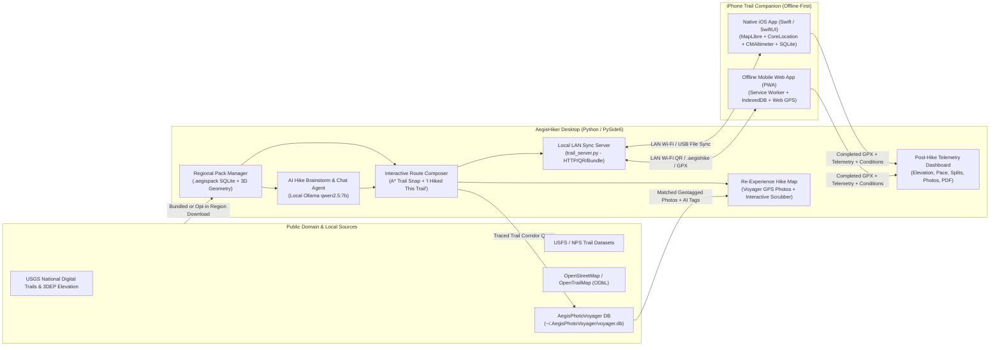

# AegisHiker: Development Plan

*Drafted 2026-10-17. Modeled on [AegisBrewMaster](file:///home/andy/projects/aegisbrewmaster/aegisbrewmaster-plan.md) and [AegisKitchenCoach](file:///home/andy/projects/aegiskitchencoach/README.md) in the Aegis privacy-first desktop & mobile companion family.*

**AegisHiker** is a local-first, offline-capable hiking trail discovery, route composition, live GPS trail tracking, and telemetry analytics suite. It pairs a **PySide6 Linux desktop application** (for regional pack management, AI-guided hike planning, interactive route composition, elevation/grade modeling, printable topo trail sheets, and post-hike telemetry archival) with a **dual-mode iPhone trail companion**:
1. **Installable Offline Mobile Web Companion (PWA)** served directly from the desktop over your local Wi-Fi via QR code (caching regional trail packs, vector/topo map data, and 3D elevation profiles into IndexedDB/CacheStorage via a Service Worker for 100% off-grid Airplane Mode navigation and live GPS logging).
2. **Native iOS Swift/SwiftUI Application (`ios/AegisHiker/`)** engineered around **MapLibre Native** (`.pmtiles` offline vector maps), **CoreLocation** (`kCLLocationAccuracyBestForNavigation` with background tracking) + **CoreMotion** (`CMAltimeter` barometric elevation), **SQLite3** spatial/FTS5 queries, **SwiftUI Charts**, and a local LAN/USB sync bridge.

Nothing uses a cloud account: public-domain and open trail datasets live locally in SQLite and vector packs, the AI runs locally through Ollama, and phone-to-desktop synchronization happens strictly over your local network or direct file/USB transfer.

---

## 1. What We Reuse from the Aegis Pattern

Everything below follows the established architecture of `aegisbrewmaster` and `aegiskitchencoach` unless a row specifies a hiking-specific adaptation.

| Area | Aegis Pattern | AegisHiker Adaptation |
| --- | --- | --- |
| **Desktop Language / UI** | Python 3, `PySide6-Essentials` (no Addons wheel) | Same (`QPainter` interactive topo/vector map canvas + charts) |
| **Mobile Companion** | `kitchen_server.py` + `src/web/kitchen.html` (LAN QR code) | **Hybrid**: (1) `trail_server.py` + offline-capable PWA (`src/web/hiker.html` + `sw.js`) for instant off-grid phone use, AND (2) native Swift/SwiftUI iOS codebase (`ios/AegisHiker/`) |
| **Local AI** | Local LLM via Ollama (`qwen2.5:7b` default, `qwen2.5:3b` fallback), CPU-friendly | Same defaults |
| **AI Safety Rails** | `llm_service.py`: refuses non-local hosts unless opted in; Pydantic JSON-schema validation with retry; prompts/replies logged to `logs/llm.jsonl` (`AEGIS_LLM_LOG=0` off) | Copy verbatim, add backcountry safety guardrails |
| **Guided Interview** | `interview_engine.py`: deterministic topic state machine; one turn = low-temp schema extraction + focused conversation turn | Reused for **Hike Brainstorm** (destination, fitness, distance, elevation ceiling, conditions, features) |
| **Chat Dock Agent** | `agent_engine.py`: tool-calling loop (max 6 iterations), page-aware system prompt, non-mutating `ProposalDialog` diff | Same loop with trail/route/pace/gear tools; proposals show before/after distance, elevation gain, max altitude, Naismith ETA |
| **Core Domain Logic** | Pure Python in `src/<domain>/`, zero Qt or DB imports, 100% unit-tested | `src/hiking/` (geodesy, snap-to-trail A* routing, DEM/3D elevation profiles, Naismith/Tobler pace math, GPX/GeoJSON, telemetry filtering) |
| **Storage** | Stdlib `sqlite3`, WAL mode, no ORM, `CREATE TABLE IF NOT EXISTS`, JSON revision snapshots (2-min autosave coalescing) | `~/.aegishiker/profiles/<name>.db` + regional `.aegispack` SQLite/PMTiles bundles in `~/.aegishiker/packs/` |
| **App State & Workers** | `AppState` (`update(fn)` autosaves and refreshes views) + `QThreadPool` background workers | Same |
| **Theming** | Authored dark theme with `LIGHT_MAP` translation and `install_theme_hooks()` | Same, alpine forest / trail-blaze emerald & amber accents (`#2E7D32` / `#FFB300`) |
| **Charts & Maps** | Hand-painted `QPainter` widgets (`gui/charts/base_chart.py`) | Interactive **Elevation & Slope Grade Chart**, **Pace/Speed Splits Chart**, **VAM Ascent Chart**, and **Vector Topo Map Canvas** |
| **PDF Export** | Qt-only: HTML → `QTextDocument` → `QPdfWriter`, chart/map widgets rendered as high-DPI PNG | **Trailhead Sheet**, **Leave-Behind Safety Card**, and **Post-Hike Telemetry Report** |
| **Files & Directories** | `~/.aegis<app>/` with `profiles/`, `settings.json`, `logs/`, `exports/`; `AEGIS_APP_DIR` override | `~/.aegishiker/` (adds `packs/` and `photos/`) |
| **Self-Test & Testing** | `main.py --test-mode` (`SELFTEST ...: OK` → `AUTOMATED_TEST_COMPLETE`), `pytest` + `pytest-timeout` + `pyflakes` | Same checks covering geospatial math, pack loading, routing, sync server, views, and PDFs |
| **Packaging** | `.deb` with bundled `/opt` venv and strict `snap` via `tools/build/` and `packaging/` | Copy and adapt `tools/build/` and `packaging/` |

**Python Dependencies:** `PySide6-Essentials`, `ollama`, `pydantic`, `requests`, `cryptography` (optional, for encrypted `.aegishike` archives), `Pillow` (optional, EXIF/photo thumbnailing). All geospatial, GPX XML, routing, and elevation calculations use pure Python stdlib (`math`, `xml.etree.ElementTree`, `sqlite3`, `heapq`, `struct`, `zlib`) so the package stays small, fast, and dependency-light.

---

## 2. System Architecture & Repository Layout



### Directory Structure

```text
main.py                             Entry point (--debug, --test-mode)
config/defaults.json                Default hiker profile (pace, units, pack weight, elevation hysteresis)
data/
  destinations_catalog.json         Index of regional destinations with bounding boxes & metadata
  gear_templates.json               Ten Essentials + seasonal/altitude gear checklists
  safety_guidelines.json            Backcountry safety, Naismith/Tobler reference, Leave No Trace
  packs/                            Bundled starter regional trail packs (public domain USGS/NPS/USFS + OSM)
    white_mountains_nh.json         New Hampshire White Mountains (Franconia Ridge, Presidential Range / Mt. Washington)
    yosemite_valley.json            Trails (3D linestrings), POIs (trailheads, peaks, water, camp), contours
    acadia_np.json
    shenandoah_central.json
    rocky_mountain_bear_lake.json
    zion_canyon.json
    mount_rainier_paradise.json
src/hiking/                         Pure Python domain layer (NO Qt, NO database, NO network)
  units.py                          km/mi, m/ft, m/s to min/km & min/mi, °C/°F, kg/lb conversions
  models.py                         Pydantic models: DestinationPack, TrailSegment, POI, Waypoint,
                                    ComposedRoute, ElevationPoint, TelemetryPoint, HikeSession,
                                    HikePhotoPin, InteractiveHikeMap, HikeBrief
  geo.py                            Haversine, bounding box math, Douglas-Peucker simplification,
                                    cross-track off-trail distance, point-to-polyline projection
  routing.py                        Trail network graph builder, nearest-vertex snapping, A* / Dijkstra
                                    shortest/scenic path routing between waypoints + freehand segments
  elevation.py                      3D coordinate profile extraction, DEM grid bilinear interpolation,
                                    hysteresis-filtered cumulative gain/loss, slope grade (%), VAM
  pace.py                           Naismith's rule, Langmuir descent adjustments, Tobler's hiking function,
                                    pack-weight & altitude modifiers, turnaround time & water calculator
  telemetry.py                      GPS accuracy filtering (<20 m), outlier rejection, moving/stopped splits,
                                    per-km/mi pace splits, planned-vs-actual route deviation analysis
  photo_matcher.py                  Matches geotagged photos to a traced trail corridor (cross-track distance
                                    buffer, projection onto cumulative trail distance & elevation, date clustering)
  hike_replay.py                    Builds persisted interactive hike replay map JSON & self-contained HTML
  filters.py                        Local dynamic trail filtering (distance, elevation, loop, surface,
                                    dog-friendly, water available, open/closed condition flags)
  gpx.py                            GPX 1.1 parser and writer (tracks, routes, waypoints, elevation, time)
  geojson_io.py                     GeoJSON FeatureCollection import/export for trails and routes
  hike_file.py                      .aegishike / .aegispack bundle import/export (optional Fernet encryption)
  interview.py                      Deterministic topic state machine for the AI Hike Brainstorm
  gear.py                           Rule-based gear & water/calorie checklist generator
  edits.py                          Non-mutating route & gear edits the AI agent may propose
src/core/                           Database, Local LLM, Voyager Bridge, Pack Downloader, LAN Sync (NO Qt)
  paths.py                          ~/.aegishiker/ layout (profiles/, packs/, photos/, maps/, exports/, logs/)
  settings.py                       Persistent user settings (units, pace baseline, voyager_db_path, Ollama)
  database.py                       SQLite WAL database + spatial bbox / FTS5 trail indexing
  voyager_bridge.py                 Read-only bridge to AegisPhotoVoyager DB (auto-detects ~/.AegisPhotoVoyager/voyager.db,
                                    photos.db, Snap $SNAP_USER_COMMON, QSettings, and 300px thumbnails)
  pack_manager.py                   Loads bundled/downloaded regional packs into local SQLite index
  pack_downloader.py                Opt-in bounding-box downloader (OSM Overpass trails + USGS 3DEP/Open-Elevation),
                                    logged to logs/network.jsonl
  trail_server.py                   LAN-only HTTP sync & PWA server (token-guarded, CSP-locked, QR payload)
  photos.py                         Trail photo import, EXIF GPS extraction or stripping, thumbnail generation
  llm_service.py                    Local Ollama client with host guard & Pydantic structured output
  llm_log.py                        JSONL prompt/reply logger (logs/llm.jsonl)
  ollama_check.py                   Local Ollama readiness & model check
  interview_engine.py               Hike Brainstorm extraction + conversation engine
  agent_engine.py                   Page-aware tool-calling loop
  agent_tools.py                    Agent tools (search_trails, get_route, estimate_pace, propose_route_changes...)
  about.py                          App metadata, safety disclaimer, privacy statement, OTHER_APPS list
src/gui/                            PySide6 desktop interface
  main_window.py                    Object/pack selector bar on top, left page navigation, right AI chat dock
  app_state.py                      Central reactive state & QThreadPool worker dispatcher
  chat_dock.py                      Page-aware AI assistant dock with ProposalDialog integration
  themes.py                         Dark/Light themes with outdoor topo palette
  widgets.py                        Reusable cards, badges, filter chips, metric tiles, QR code widget
  report.py                         Qt-only PDF generator (Trail Sheet, Leave-Behind Safety Card, Hike Report)
  help_text.py                      Tooltips and contextual help strings
  charts/
    base_chart.py                   Shared QPainter chart base
    map_canvas.py                   Interactive offline vector/topo map widget (pan, zoom, contours, trails,
                                    POIs, route drawing, photo pins, animated replay hiker cursor)
    elevation_chart.py              Interactive altitude & slope-grade profile chart with hover/replay scrubbing
    pace_chart.py                   Post-hike speed, pace splits, and barometric/GPS altitude comparison chart
  panels/
    explore_panel.py                Destination pack browser, dynamic condition filters, FTS5 trail search
    brainstorm_panel.py             AI Hike Brainstorm interview + live Hike Brief + candidate trail cards
    composer_panel.py               Route Composer: map canvas + waypoint list + "I Hiked This Trail" action
    reexperience_panel.py           "Re-Experience Hike": interactive hike map, Voyager photo pins, elevation
                                    timeline scrubber, animated playback, photo lightbox & persisted HTML export
    phone_sync_panel.py             LAN Sync & QR Bridge: pack/route push to phone, live/completed track pull
    telemetry_panel.py              Post-hike analytics: planned vs actual map, elevation, splits, photos
    library_panel.py                Saved routes, completed hike logbook, GPX/GeoJSON/.aegishike import/export
    gear_panel.py                   Ten Essentials + dynamic trip checklist & Leave-Behind Safety Card
    settings_panel.py               Hiker profile, units, AegisPhotoVoyager DB path, pack manager, Ollama
  dialogs/
    help_dialog.py                  Built-in HTML user guide (F1)
    about_dialog.py                 About, Contact, Other Aegis apps
    proposal_dialog.py              Side-by-side diff for AI route/gear proposals
    region_download_dialog.py       Opt-in bounding-box pack builder from public-domain/open sources
    condition_dialog.py             Update local trail condition flags (mud, snowline, closure, water flow)
    i_hiked_this_dialog.py          "I Hiked This Trail" wizard: trace review, Voyager photo match preview,
                                    corridor buffer slider, date cluster selector, persist interactive map
ios/AegisHiker/                     Native Swift / SwiftUI iOS Companion Project
  Package.swift                     Swift Package Manager manifest (MapLibre Native, SQLite3)
  Info.plist                        NSLocationAlwaysAndWhenInUseUsageDescription, UIBackgroundModes: location
  Sources/AegisHiker/
    AegisHikerApp.swift             SwiftUI App entry point & tab navigation
    Models/                         TrailModels.swift (Codable models matching Python Pydantic schemas)
    Services/
      LocationTrackerService.swift  CLLocationManager background tracker + CMAltimeter barometric logger
      TrailDatabaseService.swift    Local SQLite3 FTS5 & bounding-box spatial query engine + telemetry store
      RouteBuilderService.swift     On-device tap-to-snap route composer & elevation profile calculator
      LocalSyncService.swift        LAN HTTP sync client (QR token pairing) + GPX/JSON bundle importer/exporter
    Views/
      DestinationPackView.swift     Regional pack selector & local condition filter sheet
      TrailMapView.swift            MapLibre Native offline vector map (.pmtiles) + route polyline overlay
      RouteComposerView.swift       Tap-to-add waypoints, snap-to-trail, and interactive elevation preview
      ActiveHikeOverlayView.swift   Live tracking HUD, SwiftUI Charts elevation profile, distance remaining,
                                    off-trail warning banner
      SyncBridgeView.swift          One-tap LAN sync with desktop PySide6 app
  Tests/AegisHikerTests/            XCTest unit tests for models, elevation math, and SQLite queries
src/web/
  hiker.html                        Self-contained offline-capable mobile web companion (PWA)
  sw.js                             Service Worker caching app shell, regional packs, and routes for off-grid use
  manifest.json                     Web App Manifest (standalone display, offline icons)
src/assets/
  appicon.svg                       AegisHiker vector icon
  help/                             Offline HTML help documentation
tests/                              pytest suite (unit, golden geospatial/pace, AI mock, LAN sync, GUI self-test)
tools/
  build_starter_packs.py            Generates deterministic bundled regional packs in data/packs/
  build/                            Debian (.deb) and Snap package build scripts
packaging/                          Desktop entry and Debian control files
snap/                               snapcraft.yaml
```

---

## 3. Public Domain & Open Geospatial Data Architecture

AegisHiker decouples trail discovery and navigation from online servers using **Regional Destination Packs (`.aegispack`)**:

1. **Bundled Starter Regional Packs (`data/packs/`)**:
   - Ships out-of-the-box with 7 curated regional packs covering iconic public-domain U.S. National Forest & National Park trail networks:
     1. **New Hampshire White Mountains, NH** (WMNF: Franconia Ridge Loop — Falling Waters, Old Bridle Path, Little Haystack, Mt. Lincoln, Mt. Lafayette, Greenleaf Hut — plus Mt. Washington / Presidential Range via Tuckerman Ravine, Lion Head, Boott Spur, and Crawford Path)
     2. **Yosemite Valley & High Country, CA** (Mist Trail, Half Dome corridor, Four Mile Trail, Panorama Trail, Valley Loop)
     3. **Acadia National Park, ME** (Precipice, Beehive, Cadillac North/South Ridge, Jordan Pond Loop, Pemetic)
     4. **Shenandoah National Park Central, VA** (Old Rag Circuit, Whiteoak Canyon, Hawksbill, Stony Man, Appalachian Trail segment)
     5. **Rocky Mountain National Park – Bear Lake Corridor, CO** (Emerald Lake, Sky Pond, Flattop Mountain, Loch Vale, Glacier Gorge)
     6. **Zion Canyon, UT** (West Rim / Scout Lookout, Watchman Trail, Emerald Pools, Pa'rus, Canyon Overlook)
     7. **Mount Rainier – Paradise Corridor, WA** (Skyline Trail Loop, Nisqually Vista, Alta Vista, Pinnacle Peak)
   - Each pack includes:
     - Destination bounding box (`min_lat`, `min_lon`, `max_lat`, `max_lon`) and base elevation.
     - Connected 3D trail segments (`[[lon, lat, ele_m], ...]`) with junction nodes so the router can compose multi-segment loops and out-and-back hikes.
     - Trail metadata: length, elevation gain/loss, min/max altitude, surface type (`paved`, `gravel`, `rocky_trail`, `scramble`), SAC/YDS difficulty rating, dog permission, water reliability, and local condition flags (`open`, `muddy`, `snow_above_2500m`, `high_water`, `seasonal_closure`).
     - Points of Interest (POIs): `trailhead`, `peak`, `waterfall`, `water_source`, `viewpoint`, `campsite`, `shelter`, `junction`, `ranger_station`.
     - Topographic contour lines & DEM elevation grid for offline elevation interpolation and map rendering.
     - Explicit source and licensing attribution (`USGS National Digital Trails / 3DEP Public Domain` and `© OpenStreetMap contributors under ODbL`).
2. **Opt-In Regional Pack Downloader (`src/core/pack_downloader.py`)**:
   - Users can choose any general destination or bounding box on the desktop and download a regional pack for offline use.
   - Queries **OpenStreetMap Overpass API** (`highway=path|footway|track`, `sac_scale`, `name`, `surface`) and **USGS 3DEP Elevation Point Query Service / Open-Elevation** to build 3D trail geometries and a local DEM grid, saving the result as a self-contained `.aegispack` file in `~/.aegishiker/packs/`.
   - Every HTTP request is logged to `logs/network.jsonl` with timestamp, URL, and byte count; zero cookies or telemetry.
3. **Local GPX 1.1 & GeoJSON Import/Export**:
   - Import any `.gpx` or `.geojson` file from USGS, USFS, NPS, CalTopo, OsmAnd, Organic Maps, or Garmin devices directly into a regional pack or as a standalone route.

---

## 4. Database Schema & Data Model (`~/.aegishiker/profiles/default.db`)

SQLite with WAL mode enabled. Spatial queries use indexed bounding-box columns (`min_lat`, `max_lat`, `min_lon`, `max_lon`), and text discovery uses SQLite **FTS5**.

```sql
-- Regional destination packs loaded into the profile
destination_pack (
    id TEXT PRIMARY KEY,
    name TEXT NOT NULL,
    region TEXT NOT NULL,
    agency TEXT,                         -- e.g. 'NPS / USGS', 'USFS', 'OSM'
    license TEXT NOT NULL,
    min_lat REAL, max_lat REAL,
    min_lon REAL, max_lon REAL,
    base_ele_m REAL, max_ele_m REAL,
    pack_version TEXT,
    installed_at TEXT,
    data JSON NOT NULL                   -- DEM grid, contours, pack summary
);

-- Individual trail segments with spatial bounding box & condition flags
trail_segment (
    id TEXT PRIMARY KEY,
    pack_id TEXT NOT NULL REFERENCES destination_pack(id) ON DELETE CASCADE,
    name TEXT NOT NULL,
    code TEXT,                           -- official trail number/code
    difficulty TEXT NOT NULL,            -- 'easy' | 'moderate' | 'strenuous' | 'expert'
    surface TEXT NOT NULL,               -- 'paved' | 'packed_dirt' | 'rocky' | 'scramble'
    trail_type TEXT NOT NULL,            -- 'loop' | 'out_and_back' | 'segment' | 'connector'
    distance_m REAL NOT NULL,
    elevation_gain_m REAL NOT NULL,
    elevation_loss_m REAL NOT NULL,
    min_ele_m REAL NOT NULL,
    max_ele_m REAL NOT NULL,
    max_grade_pct REAL NOT NULL,
    dogs_allowed INTEGER DEFAULT 0,
    water_available INTEGER DEFAULT 0,
    condition_status TEXT DEFAULT 'open',-- 'open' | 'caution' | 'muddy' | 'snow' | 'closed'
    condition_note TEXT DEFAULT '',
    condition_updated TEXT,
    min_lat REAL NOT NULL, max_lat REAL NOT NULL,
    min_lon REAL NOT NULL, max_lon REAL NOT NULL,
    coords_3d JSON NOT NULL,             -- [[lon, lat, ele_m], ...]
    tags JSON DEFAULT '[]',
    description TEXT DEFAULT ''
);

-- Full-Text Search virtual table for instant offline trail discovery
CREATE VIRTUAL TABLE trail_fts USING fts5(
    trail_id UNINDEXED,
    name,
    description,
    tags,
    condition_note
);

-- Points of Interest (trailheads, peaks, water sources, campsites, junctions)
poi (
    id TEXT PRIMARY KEY,
    pack_id TEXT NOT NULL REFERENCES destination_pack(id) ON DELETE CASCADE,
    name TEXT NOT NULL,
    kind TEXT NOT NULL,                  -- 'trailhead'|'peak'|'water'|'waterfall'|'camp'|'viewpoint'|'junction'
    lat REAL NOT NULL,
    lon REAL NOT NULL,
    ele_m REAL NOT NULL,
    note TEXT DEFAULT ''
);

-- User-composed hike routes (snapped to trails or freehand, with revision history)
composed_route (
    id TEXT PRIMARY KEY,
    pack_id TEXT REFERENCES destination_pack(id) ON DELETE SET NULL,
    name TEXT NOT NULL,
    status TEXT DEFAULT 'planned',       -- 'planned' | 'ready_for_phone' | 'completed' | 'favorite'
    rating INTEGER DEFAULT 0,
    tags TEXT DEFAULT '',
    created TEXT NOT NULL,
    modified TEXT NOT NULL,
    parent_id TEXT,
    notes TEXT DEFAULT '',
    data JSON NOT NULL                   -- Validated ComposedRoute Pydantic JSON (waypoints, 3D path, stats, gear)
);

composed_route_revision (
    id INTEGER PRIMARY KEY AUTOINCREMENT,
    route_id TEXT NOT NULL REFERENCES composed_route(id) ON DELETE CASCADE,
    created TEXT NOT NULL,
    label TEXT NOT NULL,
    data JSON NOT NULL
);

-- Recorded GPS hike sessions OR traced "I Hiked This Trail" records
hike_session (
    id TEXT PRIMARY KEY,
    pack_id TEXT REFERENCES destination_pack(id) ON DELETE SET NULL,
    route_id TEXT REFERENCES composed_route(id) ON DELETE SET NULL,
    route_snapshot JSON,                 -- Frozen snapshot of ComposedRoute / traced 3D trail geometry
    title TEXT NOT NULL,
    started_at TEXT NOT NULL,
    ended_at TEXT,
    status TEXT DEFAULT 'completed',     -- 'tracking' | 'completed' | 'traced_hiked' | 'imported'
    device_source TEXT DEFAULT 'phone',  -- 'traced_desktop' | 'pwa_phone' | 'ios_native' | 'gpx_import'
    stats JSON NOT NULL,                 -- Computed HikeStats (distance, gain, moving_time_s, pace, VAM, photo_count)
    conditions_logged JSON DEFAULT '{}', -- Field conditions reported during the hike
    interactive_map_path TEXT,           -- Path to persisted interactive hike HTML map in ~/.aegishiker/maps/
    interactive_map_data JSON,           -- Persisted InteractiveHikeMap JSON state (3D trail, elevation, photo pins)
    notes TEXT DEFAULT '',
    created TEXT NOT NULL,
    modified TEXT NOT NULL
);

-- Geotagged photos matched from AegisPhotoVoyager (or phone sync) onto a hike trail
hike_photo_pin (
    id TEXT PRIMARY KEY,
    session_id TEXT NOT NULL REFERENCES hike_session(id) ON DELETE CASCADE,
    voyager_photo_id INTEGER,            -- Foreign reference to AegisPhotoVoyager photos.id
    photo_path TEXT NOT NULL,            -- Full path to photo file
    thumb_path TEXT,                     -- ~/.AegisPhotoVoyager/thumbnails/{id}_300.jpg or local thumb
    filename TEXT NOT NULL,
    date_taken INTEGER,                  -- UTC Unix timestamp from Voyager
    lat REAL NOT NULL,
    lon REAL NOT NULL,
    ele_m REAL NOT NULL,                 -- Projected elevation on the trail profile
    distance_along_m REAL NOT NULL,      -- Cumulative distance along the traced hike (0 .. total_distance_m)
    cross_track_m REAL DEFAULT 0.0,      -- Perpendicular distance from photo GPS to the trail centerline
    camera_model TEXT DEFAULT '',
    is_starred INTEGER DEFAULT 0,
    ai_summary TEXT DEFAULT '',          -- Pulled from Voyager ai_analysis.summary
    ai_tags JSON DEFAULT '[]',           -- Pulled from Voyager ai_analysis.tags_json
    ai_mood TEXT DEFAULT '',             -- Pulled from Voyager ai_analysis.mood
    people JSON DEFAULT '[]',            -- Identified face names from Voyager faces/persons tables
    caption TEXT DEFAULT ''              -- User-editable hike journal caption
);

-- High-frequency GPS & Barometric telemetry points for a hike session
telemetry_point (
    id INTEGER PRIMARY KEY AUTOINCREMENT,
    session_id TEXT NOT NULL REFERENCES hike_session(id) ON DELETE CASCADE,
    seq INTEGER NOT NULL,
    timestamp TEXT NOT NULL,
    lat REAL NOT NULL,
    lon REAL NOT NULL,
    gps_ele_m REAL NOT NULL,
    baro_ele_m REAL,                     -- Optional barometric altimeter reading
    horizontal_accuracy_m REAL DEFAULT 5.0,
    speed_mps REAL DEFAULT 0.0,
    grade_pct REAL DEFAULT 0.0
);

-- Field waypoints and notes captured on the trail
waypoint_note (
    id TEXT PRIMARY KEY,
    session_id TEXT REFERENCES hike_session(id) ON DELETE CASCADE,
    route_id TEXT REFERENCES composed_route(id) ON DELETE CASCADE,
    name TEXT NOT NULL,
    kind TEXT DEFAULT 'note',            -- 'note' | 'water' | 'hazard' | 'photo' | 'summit'
    lat REAL NOT NULL,
    lon REAL NOT NULL,
    ele_m REAL NOT NULL,
    created_at TEXT NOT NULL,
    photo_filename TEXT,                 -- Stored in ~/.aegishiker/photos/
    note TEXT DEFAULT ''
);

-- AI Brainstorm brief and Chat Dock messages
hike_brief (
    id TEXT PRIMARY KEY,
    route_id TEXT,
    data JSON NOT NULL,
    created TEXT NOT NULL,
    modified TEXT NOT NULL
);

chat_message (
    id INTEGER PRIMARY KEY AUTOINCREMENT,
    route_id TEXT,
    channel TEXT NOT NULL,               -- 'brainstorm' | 'chat'
    role TEXT NOT NULL,                  -- 'user' | 'assistant' | 'system'
    content TEXT NOT NULL,
    created TEXT NOT NULL
);
```

---

## 5. Feature Plan

### F1 · Regional Destination Packs & Local Dynamic Trail Discovery
- **Destination Pack workflow**: Users choose a general destination (e.g., *New Hampshire White Mountains*, *Yosemite*, *Acadia*, *Shenandoah*, or a custom downloaded bounding box) and load its regional pack.
- **Local SQLite + Spatial & FTS5 Search**: Search by trail name, peak, waterfall, or feature (`trail_fts`), or pan the map to query `trail_segment` rows intersecting the viewport bounding box (`min_lat <= view_max_lat AND max_lat >= view_min_lat ...`).
- **Dynamic Local Condition Filtering**: Filter trails instantly offline by:
  - Distance range (km / mi) and Elevation Gain ceiling (m / ft)
  - Max altitude (for acclimatization or snowline thresholds)
  - Difficulty (`easy`, `moderate`, `strenuous`, `expert`) and Trail Type (`loop`, `out_and_back`, `segment`)
  - Local Condition Flags (`open` only, hide `snow` / `muddy` / `high_water` / `closed`)
  - Attributes (`dogs_allowed`, `water_available`)
- **Field Condition Updates**: Users can update condition flags on any trail segment (e.g., *"Snow bridge out at 2,400 m"*) on either the phone or desktop; updates sync back and dynamically adjust filter results.

### F2 · Guided Hike Brainstorm with Local AI
- Follows the deterministic Aegis interview state machine (`src/hiking/interview.py` + `src/core/interview_engine.py`) over 7 topics:
  1. **Destination / Regional Pack** (which park/region or local pack)
  2. **Hiker Party & Fitness** (solo, family with kids, dogs, baseline flat pace)
  3. **Distance & Time Window** (target km/mi or available hours, start time vs. sunset)
  4. **Elevation Gain & Altitude Ceiling** (comfortable climb and max elevation)
  5. **Desired Scenery & Route Shape** (loop vs. out-and-back, peaks, waterfalls, solitude)
  6. **Current Weather & Trail Conditions** (heat, rain, mud, snowline, water availability)
  7. **Gear & Pack Weight** (daypack vs. overnight load, trekking poles)
- **Live Hike Brief card** on the right displays extracted parameters (marked `stated` vs. `inferred`, clickable to edit).
- **Code-Verified Candidate Matching**: When the brief is ready, deterministic Python code (`src/hiking/filters.py` + `routing.py`) filters and ranks candidate trails and multi-segment loops from the active regional pack that strictly obey hard rules (dog rules, closures, distance/elevation caps, daylight window). The local LLM explains *why* each candidate fits and can draft a custom composed route.

### F3 · Interactive Route Composer & Altitude/Grade Profile
- **Map Canvas (`gui/charts/map_canvas.py`)**:
  - Pure `QPainter` vector/topo canvas rendering topographic elevation contours, hillshade tint, water bodies, regional trail segments color-coded by difficulty/condition, and POIs (trailheads, peaks, water sources, junctions).
  - Supports smooth pan/zoom, layer toggles (contours, POIs, conditions, hillshade), and click-to-inspect trail segments.
- **Tap-to-Snap & Freehand Route Builder (`src/hiking/routing.py`)**:
  - **Snap-to-Trail Mode**: Clicking waypoints or trail segments runs A* shortest-path routing across connected trail junction nodes, automatically stitching multi-trail loops or out-and-back routes and extracting 3D coordinates `[lon, lat, ele_m]`.
  - **Freehand / Bushwhack Mode**: Add off-trail waypoints; elevation is bilinearly interpolated from the regional pack's DEM grid.
  - Actions: **Reverse Route**, **Make Out-and-Back (Return to Start)**, **Close Loop via Trails**, **Undo Waypoint**, **Clear**, and **"✓ I Hiked This Trail"**.
- **Interactive Altitude & Grade Chart (`gui/charts/elevation_chart.py`)**:
  - Plots elevation (m or ft) along cumulative distance (km or mi).
  - Color-codes segments under the curve by slope steepness (`< 8%` gentle green, `8–15%` moderate amber, `> 15%` steep coral/red).
  - Marks POIs (summits, water sources, trail junctions) directly on the elevation profile.
  - **Bidirectional Scrubbing**: Hovering anywhere on the elevation chart moves a synchronized cursor on the map canvas and displays distance, altitude, grade%, and cumulative climb/descent at that point.
- **Pace, Daylight & Hydration Sidebar (`src/hiking/pace.py`)**:
  - Computes estimated duration using **Naismith's Rule + Langmuir descent corrections** and **Tobler's Hiking Function**, adjusted for pack weight and altitude.
  - Calculates **Turnaround Time**, **Estimated Finish Time**, **Recommended Water (L / oz)**, and **Estimated Calories**.

### F4 · "I Hiked This Trail" — AegisPhotoVoyager Integration & Interactive Hike Replay Map
Allows users to log any past hike by tracing the trail and automatically discovering and pinning photos from their **AegisPhotoVoyager** library:
1. **Select Region & Trace Trail**:
   - User selects a Regional Destination Pack (or custom area) and traces the trail they hiked on the Route Composer map (via tap-to-snap A* trail routing, picking an existing trail, or freehand tracing).
2. **Create & Persist Completed Hike Record**:
   - Clicking **"✓ I Hiked This Trail"** opens `IHikedThisDialog` (`gui/dialogs/i_hiked_this_dialog.py`) and persists a `hike_session` record (`status='traced_hiked'`) in SQLite (`~/.aegishiker/profiles/default.db`) with the 3D trail polyline, elevation profile, total distance, cumulative climb/descent, date hiked, and journal notes.
3. **Auto-Locate & Query `AegisPhotoVoyager` Database (`src/core/voyager_bridge.py`)**:
   - Automatically discovers `AegisPhotoVoyager`'s SQLite database in priority order (mirroring `aegisexpedition`):
     1. User-configured override (`voyager_db_path` in `settings.json` or `AEGIS_VOYAGER_DB` environment variable)
     2. Standard Voyager path: `~/.AegisPhotoVoyager/voyager.db` and `~/.AegisPhotoVoyager/photos.db`
     3. Snap user common path: `$SNAP_USER_COMMON/.AegisPhotoVoyager/voyager.db` and `~/snap/aegisphotovoyager/common/.AegisPhotoVoyager/voyager.db`
     4. `QSettings("Aegis", "PhotoVoyager")` probe (`app_data_dir`)
     5. Legacy XDG paths (`~/.local/share/AegisPhotoVoyager/voyager.db` or `photos.db`)
   - Also locates Voyager's pre-generated 300px thumbnails in `<voyager_data_dir>/thumbnails/{photo_id}_300.jpg`.
   - Opens the Voyager DB in read-only URI mode (`file:<db_path>?mode=ro`) and queries `photos` (joined with `ai_analysis` and `faces`/`persons`) within the traced trail's bounding box (`p.is_deleted = 0 AND p.is_hidden = 0 AND p.lat IS NOT NULL AND p.lon IS NOT NULL`).
4. **GPS Corridor Matching & Trail Progression Projection (`src/hiking/photo_matcher.py`)**:
   - Computes exact perpendicular cross-track distance from each candidate photo's `(lat, lon)` to the traced trail polyline (`geo.py`).
   - Keeps photos within a configurable corridor buffer (default `250 m`, adjustable slider `50 m – 1,000 m`).
   - Groups matched photos by calendar date (`date_taken`) so if the user hiked the trail on a specific day (or multiple times), they can select the date cluster or include all matching photos.
   - Projects each matched photo onto the traced 3D polyline to compute its exact **distance along the hike (`distance_along_m`)** and **interpolated altitude (`ele_m`)**, and persists `hike_photo_pin` rows with Voyager's AI summary, tags, mood, and identified people.
5. **Persist & Interact with the "Re-Experience Hike" Map (`src/hiking/hike_replay.py` + `gui/panels/reexperience_panel.py`)**:
   - Creates and persists an interactive hike experience both inside the database (`hike_session.interactive_map_data`) and as a standalone, self-contained interactive HTML map (`~/.aegishiker/maps/<hike_id>.html`).
   - **Desktop "Re-Experience Hike" Panel (`reexperience_panel.py`)**:
     - **Interactive Topo Map with Photo Pins**: Displays the traced trail, topographic contours, POIs, and clickable photo pins clustered/numbered along the route.
     - **Synchronized Elevation & Photo Scrubber**: Shows photo camera markers at their exact distance and altitude along the elevation profile.
     - **Animated Hike Playback ("Play Hike")**: Play/Pause/Speed controls animate a hiker marker along the trail and altitude curve from trailhead to summit to finish, automatically displaying each photo card, timestamp, elevation, slope grade, Voyager AI description, identified people, and journal notes as the hiker passes each photo location.
     - **Standalone HTML Export**: The persisted `~/.aegishiker/maps/<hike_id>.html` file embeds the vector topo map, interactive elevation scrubber, animated playback, and base64 thumbnails so the user can also open and re-experience the hike in any browser offline.

### F5 · Offline-First Phone Companion (LAN PWA + Service Worker)
- Modeled on `AegisKitchenCoach`'s `kitchen_server.py`, upgraded for multi-day off-grid backcountry use (`src/core/trail_server.py` + `src/web/hiker.html` + `src/web/sw.js`):
  - **Strict Local Privacy**: Binds only to the computer's LAN IP, refuses non-private IPs, guards every session with a cryptographic random token (`/h/<token>`), and enforces a strict Content-Security-Policy (`connect-src 'self'`).
  - **Download Regional Pack to Phone**: Scanning the QR code on the iPhone opens `hiker.html`, which downloads the entire selected **Regional Destination Pack** (all trails, 3D geometries, POIs, condition flags, contours) plus the user's **Composed Routes** into **IndexedDB** and caches the app shell via **Service Worker (`sw.js`)**.
  - **Pick Per Local & Current Conditions at the Trailhead**: Because the entire regional pack is stored on the phone offline, if the user arrives at the destination and finds a trailhead full or weather changed, they can filter all local trails in the region by distance, elevation, loop, or condition and switch routes completely offline.
  - **Live GPS Tracking & Safety Overlay on Phone**:
    - Uses `navigator.geolocation.watchPosition({ enableHighAccuracy: true })` + Screen Wake Lock (with silent media fallback).
    - Records `[lat, lon, ele, accuracy, speed, timestamp]` into IndexedDB every ≥ 5 m (`horizontalAccuracy < 20 m`).
    - Renders an interactive touch vector map with live blue GPS dot, bread-crumb track, composed route line, **Live Elevation Profile Chart** with current-position marker, **Distance & Climb Remaining**, and an **Off-Trail Warning Banner** if cross-track distance exceeds threshold (default 50 m).
    - Allows dropping field waypoints, updating trail condition flags, and snapping a trail photo.

### F6 · Native iOS Swift/SwiftUI App (`ios/AegisHiker/`)
- Full native iOS project in `ios/AegisHiker/` directly implementing and expanding the Google Doc specification:
  - **`LocationTrackerService.swift`**: Implements `CLLocationManagerDelegate` with `kCLLocationAccuracyBestForNavigation`, `activityType = .fitness`, `distanceFilter = 5.0`, `allowsBackgroundLocationUpdates = true`, `pausesLocationUpdatesAutomatically = false`, accuracy gate (`horizontalAccuracy >= 0 && horizontalAccuracy < 20`), plus **`CMAltimeter`** barometric relative/pressure elevation logging.
  - **`TrailDatabaseService.swift`**: Native `SQLite3` wrapper querying regional `.aegispack` databases using bounding-box spatial queries and FTS5, plus recording real-time GPS telemetry rows on-device.
  - **`TrailMapView.swift` & `RouteComposerView.swift`**: **MapLibre Native for iOS** integration rendering offline vector tiles (`.pmtiles`) and 3D trail polylines, with tap-to-snap route composition.
  - **`ActiveHikeOverlayView.swift`**: SwiftUI `Charts` real-time elevation profile graph, current position progress along the altitude curve, distance/elevation remaining, and off-trail alert.
  - **`LocalSyncService.swift`**: Discovers and pairs with the desktop `trail_server.py` over LAN Wi-Fi (or exports/imports `.aegishike` / `.gpx` bundles via the iOS Files app / USB).

### F7 · Local-First Sync Bridge (Desktop ⟷ iPhone)
- **Two-Way Local Sync (`Phone Sync` panel)**:
  1. **Desktop → Phone**: Push regional destination packs (`.aegispack`), composed routes, and updated trail condition flags over LAN Wi-Fi (via QR code) or export as a portable `.aegishike` / `.gpx` bundle.
  2. **Phone → Desktop**: One-tap **"Sync Hike to Desktop"** button on the phone (`POST /h/<token>/sync`) transfers completed GPS telemetry tracks, recorded waypoints, field condition reports, custom routes composed on the phone, and trail photos directly into the desktop SQLite database.
  3. **Offline File / USB Fallback**: Export a `.aegishike` JSON/GPX bundle from the phone to iCloud Drive/USB/AirDrop and import it into the desktop app with drag-and-drop.

### F8 · Desktop Telemetry Dashboard & Post-Hike Analytics
- Dedicated PySide6 **Telemetry & Logbook** view (`gui/panels/telemetry_panel.py`):
  - **Planned vs. Actual Map Overlay**: Draws the planned route in dashed cyan and the recorded GPS track in solid emerald/amber (color-coded by pace or heart rate/grade).
  - **Multi-Series Elevation Chart**: Compares Planned DEM Elevation vs. Recorded GPS Altitude vs. Barometric Altimeter readings over distance or elapsed time.
  - **Speed, Pace & Grade Chart (`gui/charts/pace_chart.py`)**: Plots moving speed (km/h or mph), pace (min/km or min/mi), and VAM (vertical ascent meters/hour) across kilometer/mile splits.
  - **Summary Metrics**: Total distance, moving time, stopped time, average pace, moving pace, total ascent/descent, min/max altitude, max off-trail deviation, and calories burned.
  - **Trail Photos & Field Notes**: Displays geotagged photos taken during the hike pinned to their exact locations on the map and elevation chart.

### F9 · Page-Aware Trail Chat Agent & Non-Mutating Proposals
- Docked right-hand chat assistant (`src/core/agent_engine.py` + `agent_tools.py`) with tools:
  - `list_destinations()`, `search_trails(query, max_distance_km, max_gain_m, difficulty, dogs_only)`
  - `get_trail_details(trail_id)`, `check_trail_conditions(pack_id)`
  - `get_current_route()`, `get_elevation_profile()`, `estimate_hike_pace(pack_weight_kg, start_time)`
  - `get_hike_history()`, `get_session_telemetry(session_id)`, `find_voyager_photos_for_route()`
  - `propose_route_changes(summary, edits[])` with actions: `use_trail`, `append_segment`, `remove_waypoint`, `reverse_route`, `make_out_and_back`, `swap_alternate_segment`.
  - `propose_gear_changes(summary, items[])`
- Every proposed route edit is applied to an in-memory copy and presented in `ProposalDialog` showing a side-by-side diff of waypoints and **Before vs. After Distance, Elevation Gain, Max Altitude, Max Grade%, and Estimated Duration**. Nothing mutates `AppState` unless the user clicks **Accept**.

### F10 · Gear Checklist & Backcountry Safety Card
- Generates a customized **Ten Essentials + Trip Gear Checklist** (`src/hiking/gear.py`) based on route distance, elevation gain, max altitude, weather/condition flags (e.g., microspikes if `snow`, extra water if dry trail, headlamp if finish is within 2 hours of sunset), and dog/kid flags.
- Includes a **Leave-Behind Emergency Safety Card** generator (who is hiking, vehicle description & trailhead parking lot, planned route & alternate bad-weather bailout route, expected return time, overdue panic time, and ranger/SAR emergency numbers).

### F11 · Printable Trail Sheet & Post-Hike Report PDF
- Qt-only rendering (`src/gui/report.py` via `QTextDocument` → `QPdfWriter`), supporting Letter and A4:
  1. **Trailhead Topo & Route Sheet**: High-DPI vector map snapshot with route and waypoints, Elevation & Grade Profile chart, junction-by-junction Naismith timetable, water sources, condition warnings, and gear checklist.
  2. **Backcountry Leave-Behind Safety Sheet**: One-page emergency plan to leave on a car dashboard or with a trusted contact.
  3. **Post-Hike Telemetry & Photo Story Report**: Completed hike summary, planned-vs-actual stats table, elevation and pace split charts, field notes, and thumbnails + captions of matched `AegisPhotoVoyager` trail photos.

---

## 6. Desktop Screens & Navigation

Left navigation sidebar (`QListWidget`), top active-destination & route selector bar, and right collapsible AI Chat Dock:

| Page | Purpose |
| --- | --- |
| **1. Explore Region** | Select a Regional Destination Pack, inspect interactive topo map, filter trails offline by distance/elevation/conditions, update trail condition flags |
| **2. Hike Brainstorm** | Guided local-AI interview + live Hike Brief card → code-verified trail & loop recommendations |
| **3. Route Composer** | Interactive map + tap-to-snap A* route builder + synchronized Altitude/Grade chart + **"✓ I Hiked This Trail"** action |
| **4. Re-Experience Hike** | Interactive hike replay map with pinned **AegisPhotoVoyager** photos, animated trail & elevation timeline scrubber, photo story cards, and persisted standalone HTML map export |
| **5. Phone Sync** | LAN QR code bridge + offline PWA launcher + one-tap telemetry sync + `.aegishike` / `.gpx` bundle import/export |
| **6. Telemetry & Log** | Post-hike analytics dashboard: planned vs. actual GPS track, elevation/baro comparison, kilometer/mile pace splits, VAM, trail photos |
| **7. Gear & Safety** | Dynamic Ten Essentials checklist, water/calorie calculator, Leave-Behind Emergency Card |
| **8. Library** | Saved routes, revision history, completed & traced hike archive, GPX 1.1 & GeoJSON batch import/export |
| **9. Settings** | Metric/Imperial units, hiker baseline pace & weight, **AegisPhotoVoyager DB Path** (auto-detect + browse), Regional Pack Manager, Ollama model config, dark/light theme |

Dialogs: **Help (F1)**, **About**, **Contact**, **Other Aegis Apps**, **"I Hiked This Trail" Wizard (Voyager Photo Matcher)**, **Proposed Route Change (Diff)**, **Download Regional Pack**, **Trail Condition Editor**, **Export PDF Options**, **First-Run Ollama Check**.

---

## 7. Implementation Milestones

Every milestone ends with `.venv/bin/python -m pytest` green and `python main.py --test-mode` printing `AUTOMATED_TEST_COMPLETE`.

| # | Milestone | Contents | Done When |
| --- | --- | --- | --- |
| **M0** | **Skeleton & Aegis Core** | Project scaffolding (`main.py`, `run.sh`, `requirements.txt`, `pytest.ini`), `paths.py`, `settings.py`, `about.py`, `llm_service.py`, `llm_log.py`, `ollama_check.py`, `themes.py`, `widgets.py`, `MainWindow` shell, Help/About/Contact/Other Apps dialogs, `--test-mode` harness | App launches cleanly in dark & light themes; `--test-mode` passes |
| **M1** | **Hiking Core & Bundled Packs** | Pure Python `src/hiking/` (`units`, `models`, `geo`, `elevation`, `routing`, `pace`, `telemetry`, `photo_matcher`, `hike_replay`, `filters`, `gpx`, `geojson_io`, `gear`, `hike_file`); `tools/build_starter_packs.py` generating 7 detailed regional packs (including New Hampshire White Mountains) in `data/packs/`; SQLite schema + FTS5 + spatial bbox index | 100% unit & golden test coverage for Haversine, DEM elevation gain/loss, A* trail routing, photo corridor projection, Naismith/Tobler pace, and GPX 1.1 round-trip |
| **M2** | **Explore Region, Route Composer & "I Hiked This Trail"** | `map_canvas.py`, `elevation_chart.py`, `ExplorePanel`, `ComposerPanel`, `voyager_bridge.py` (auto-detecting `~/.AegisPhotoVoyager/voyager.db`), `IHikedThisDialog`, `ReexperiencePanel` (interactive hike map + animated scrubber + persisted HTML map), `LibraryPanel`, `RegionDownloadDialog` | Users can select a region, trace a trail, record "I Hiked This Trail", match GPS photos from `AegisPhotoVoyager`, and interact with the persisted hike replay map |
| **M3** | **Phone Sync Bridge, Offline PWA & Native iOS** | `trail_server.py` (LAN-only token-guarded HTTP server), `src/web/hiker.html` + `sw.js` (installable offline PWA with IndexedDB regional pack storage, offline map/elevation chart, Web GPS tracker, and one-tap sync back), `PhoneSyncPanel` with QR code, plus full `ios/AegisHiker/` Swift/SwiftUI Xcode/SPM project | Phone can load a regional pack over LAN, filter trails offline, compose/track a GPS hike, and sync telemetry + photos back to desktop |
| **M4** | **Telemetry Dashboard, Gear & Printable PDFs** | `TelemetryPanel` (`pace_chart.py`, planned-vs-actual map & elevation overlay, split table, photo pins), `GearPanel` (dynamic checklist + emergency card), `report.py` (Trailhead Sheet, Leave-Behind Safety Card, and Post-Hike Telemetry PDF templates) | Recorded, traced, or imported GPX hikes render full telemetry charts and export clean Letter/A4 PDFs |
| **M5** | **AI Hike Brainstorm & Trail Chat Agent** | `interview.py` + `interview_engine.py` (`BrainstormPanel`), `agent_engine.py` + `agent_tools.py` + `edits.py` (`ChatDock` + `ProposalDialog`) | Guided interview produces code-verified trail matches, and chat agent proposes route/gear edits with before/after elevation & pace diffs |
| **M6** | **Polish, Documentation & Packaging** | Built-in HTML Help Guide (`src/assets/help/`), `README.md`, `PACKAGING.md`, `LICENSES.html`, `.deb` and strict `snap` build scripts in `tools/build/`, full headless + package smoke tests | `pytest`, `pyflakes`, `main.py --test-mode`, and `.deb` / `snap` package builds all succeed |

---

## 8. Verification & Testing Strategy

1. **Unit & Golden Geospatial Tests (`tests/test_hiking_core.py`)**:
   - Haversine distance, bounding-box intersection, cross-track off-trail distance, point-to-polyline projection, and Douglas-Peucker simplification against known geographic coordinates.
   - Elevation profile extraction, hysteresis-filtered cumulative climb/descent, and grade% calculations against synthetic and real USGS 3DEP profiles.
   - A* trail graph snapping and multi-segment loop composition across trail junctions.
   - Naismith's Rule, Langmuir steep-descent adjustments, and Tobler's hiking function against published backcountry pace tables.
   - GPX 1.1 and GeoJSON round-trip serialization (preserving 3D coordinates, timestamps, and waypoints).
2. **"I Hiked This Trail" & `AegisPhotoVoyager` Bridge Tests (`tests/test_voyager_and_replay.py`)**:
   - Creates a fixture `voyager.db` with `photos`, `ai_analysis`, `faces`, and `persons` rows (inside and outside the trail corridor).
   - Verifies `VoyagerBridge` auto-detection, read-only queries, `photo_matcher.py` cross-track corridor filtering, projection onto `distance_along_m` and `ele_m`, date clustering, SQLite persistence of `hike_session` + `hike_photo_pin`, and generation of the persisted interactive hike map (`~/.aegishiker/maps/<hike_id>.html`).
3. **Database, Spatial & FTS5 Discovery Tests (`tests/test_database_and_packs.py`)**:
   - Loading all 7 bundled regional packs, spatial bounding-box queries, FTS5 keyword queries, dynamic condition filtering, and route revision coalescing.
4. **LAN Sync Server & Offline PWA Tests (`tests/test_trail_server.py`)**:
   - Private-IP enforcement (rejecting public IPs), token validation, Content-Security-Policy header verification, regional pack download endpoint, and telemetry/GPX/photo upload endpoint.
5. **AI Brainstorm & Agent Proposal Tests (`tests/test_ai_engines.py`)**:
   - Deterministic fake Ollama client verifying topic progression, `HikeBrief` schema extraction, hard constraint enforcement (dogs, closures, distance/elevation caps), and non-mutating route edit proposals.
6. **Headless Self-Test (`python main.py --test-mode`)**:
   - Verifies bundled packs, core calculators, SQLite indexing, `VoyagerBridge` & interactive hike replay map generation, every GUI panel and chart widget, LAN server startup/shutdown, and all 3 PDF templates in headless (`QT_QPA_PLATFORM=offscreen`) mode.


